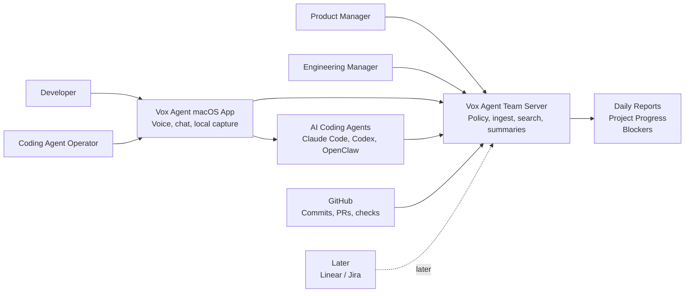
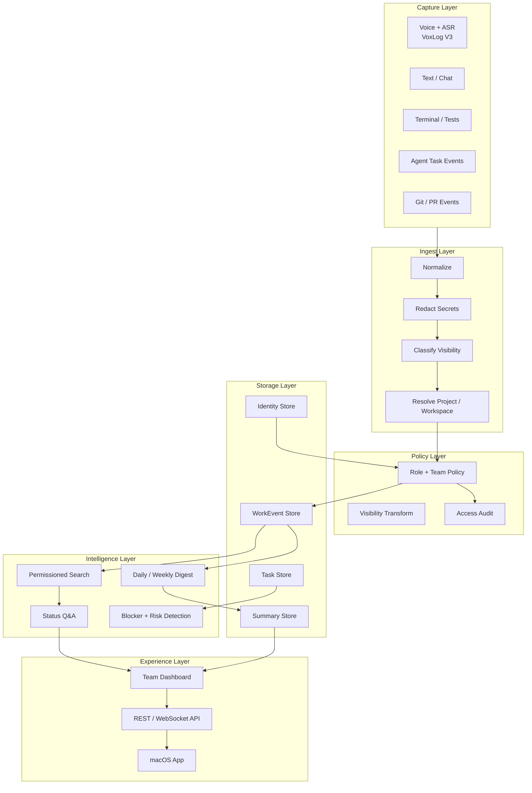
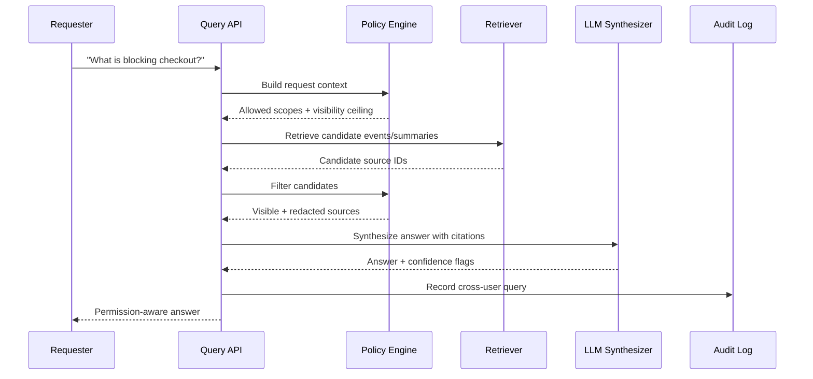
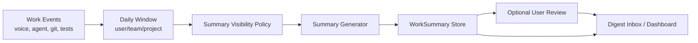
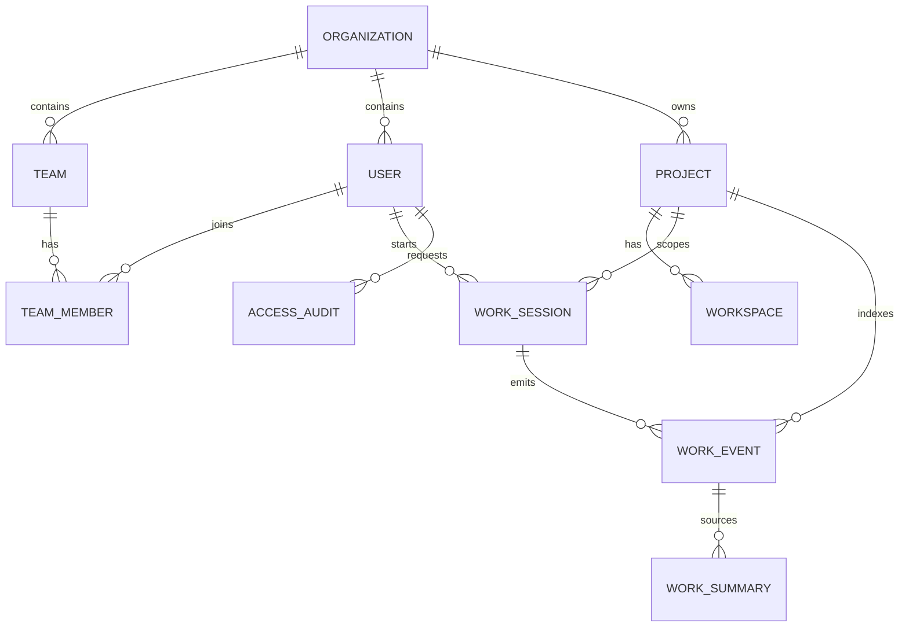
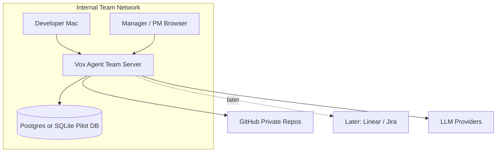

# Vox Agent Organization Edition — Architecture Diagrams

> Version: 0.2
> Date: 2026-05-17
> Status: Draft

## 1. System Context

## 2. Layered Architecture

## 3. Permissioned Query Flow

## 4. Daily Summary Flow

## 5. Org Data Model

## 6. Recommended v1 Deployment

